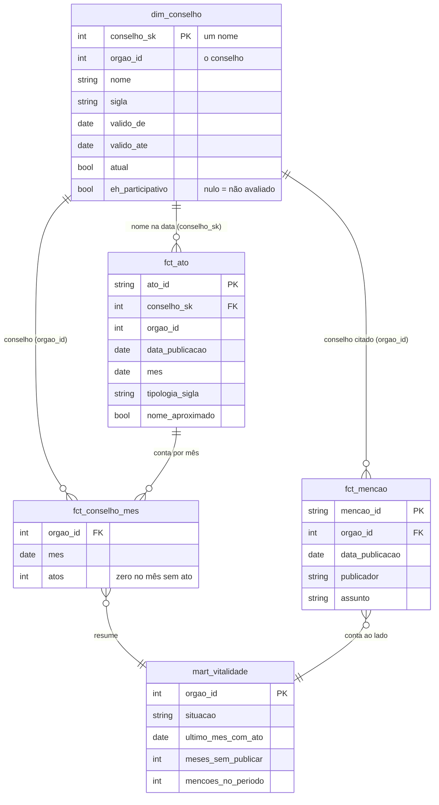

# Arquitetura final

Este é o desenho que o projeto entrega ao fim da E4. Ele parte de uma regra: **a pesquisadora usa um app só**, com três abas, e não precisa saber o que roda por trás. Todo o resto existe para alimentar essas três abas e para cumprir o que a disciplina pede em cada entrega.

<ArquiteturaInterativa />

Clique numa parte para ver o que ela faz, a ferramenta e o porquê, ou percorra o caminho do dado passo a passo. O mesmo desenho, estático, está em <a href="/conselhos-vivos/arquitetura-final.svg" target="_blank">arquitetura-final.svg</a>.

## Como o dado anda

1. **Entrada.** Uma vez por mês, o ingestor em Python baixa o ZIP da Imprensa Nacional e grava cada ato no Postgres, com o texto e o link da publicação.
2. **Curadoria.** A tipologia e a identidade dos conselhos ficam no mesmo Postgres, sem nada ser sobrescrito ([ADR 0001](/docs/adr/0001-adotar-sistema-de-curadoria-insert-only-como-oltp)).
3. **Análise.** As mudanças vão por CDC para a silver em Delta. O dbt, rodando no DuckDB, monta a gold: fatos, dimensões com histórico e as métricas de vitalidade. As menções aos conselhos em atos de **outros** órgãos, lidas do mesmo ZIP do DOU, entram como um segundo sinal de vida ([ADR 0009](/docs/adr/0009-modelar-a-gold-em-estrela-com-dbt-e-orquestrar-com-dagster)).
4. **Volta para quem decide.** As métricas viram alertas, gravados de volta no Postgres. É o ETL reverso: a pesquisadora vê o alerta na aba Revisar e reclassifica se precisar.
5. **Perguntas.** O texto dos atos é indexado pela busca textual do próprio Postgres, em português. A aba Perguntar acha os atos e pede a resposta à API do Claude, citando cada um.

O RAG lê só o Postgres. O lakehouse fica fora do caminho das perguntas, então uma falha na parte analítica não derruba o assistente.

## A gold em estrela: dimensão, fatos e mart

A gold é um modelo em estrela ([ADR 0009](/docs/adr/0009-modelar-a-gold-em-estrela-com-dbt-e-orquestrar-com-dagster)): uma dimensão no centro, três fatos em volta, cada um com o grão declarado, e um mart que responde à pergunta da E1. Uma tabela por ato não teria linha para o mês sem ato, e é a ausência que diz se um conselho parou. Por isso o fato mensal guarda os zeros.

| Tabela | Tipo | Uma linha por | Para quê |
|---|---|---|---|
| `dim_conselho` | dimensão, SCD tipo 2 | nome que o conselho teve, com a vigência | renomear é inserir; o fato pega o nome que valia na data |
| `fct_ato` | fato | matéria do próprio conselho, na versão mais recente | o que o conselho publicou e a tipologia, ligado ao nome da data por asof join |
| `fct_conselho_mes` | fato agregado | conselho × mês coberto pelo DOU, com zero no mês sem ato | o silêncio vira linha, e pode ser testado |
| `fct_mencao` | fato | matéria de outro órgão × conselho citado | o segundo sinal de vida, o enriquecimento da E3 |
| `mart_vitalidade` | mart, a camada de consumo | conselho | a situação (ativo, em silêncio, sem ato no período coberto) e as menções ao lado |
| `freshness_vitalidade` | view de controle | uma linha só | o último mês coberto contra o SLA do dia 20 |

A dimensão tem duas chaves. A `conselho_sk` é substituta e aponta um nome; a `orgao_id` é durável e aponta o conselho, com todos os nomes. O `fct_ato` guarda as duas, porque precisa do nome da época. O fato mensal e o das menções contam por conselho, então usam só a durável.

As colunas são as principais de cada modelo; a lista completa, com as descrições e os testes, está no <a href="/conselhos-vivos/linhagem/catalogo-dbt.html" target="_blank">catálogo do dbt</a>. A linhagem de cada tabela está em <a href="/conselhos-vivos/linhagem">Linhagem dos dados</a>.

## Ferramentas

| Parte | Ferramenta | Situação | Por que essa |
|---|---|---|---|
| Infra e comandos | Docker Compose + `make` | ✅ já tem | tudo sobe com um comando |
| Ingestão | Python (`src/dou`, biblioteca padrão + `psycopg`) | ✅ já tem | a migração do Go para Python |
| OLTP e curadoria | PostgreSQL 16 | ✅ já tem | [ADR 0002](/docs/adr/0002-manter-postgresql-como-motor-do-oltp) |
| CDC | slot de replicação lógica do Postgres | ✅ já tem | [ADR 0007](/docs/adr/0007-propagar-mudancas-por-slot-de-replicacao-logica), sem Kafka |
| Silver | Delta Lake, pela biblioteca `deltalake` | ✅ já tem | [ADR 0006](/docs/adr/0006-armazenar-a-camada-analitica-em-tabelas-delta) |
| Motor analítico | DuckDB | ✅ já tem | lê o Delta direto, sem servidor |
| Gold e testes de dados | dbt-core + dbt-duckdb | ✅ E3 | modelos em SQL versionados, com testes de esquema, unicidade e integridade |
| Camada semântica | métricas definidas no dbt | 🆕 E4 | uma definição só, usada pelo painel e pelos alertas |
| Orquestração | Dagster, com a opção nula cron + `make` | ✅ E3 | partições mensais dão o backfill e o retry por configuração |
| Enriquecimento | menções de outros órgãos no DOU (`src/mencoes`, `fct_mencao`) | ✅ E3 | automático no job mensal, sem download novo; SIORG completo, Seção 2 e Brasil Participativo ficam para depois |
| ETL reverso | script Python, disparado pelo orquestrador | 🆕 E4 | lê a gold e grava os alertas no Postgres |
| Busca do RAG | busca textual do Postgres (`tsvector`, em português) | 🆕 | já vem no banco: sem extensão, sem modelo de embedding, sem conta a mais |
| Respostas do RAG | API do Claude, pelo SDK `anthropic` | 🆕 | escreve a resposta a partir dos trechos achados |
| App da pesquisadora | Streamlit | ✅ E3 (aba Painel) | um app Python, com as três abas |
| Catálogo e linhagem | `dbt docs`, publicado no site, e a [linhagem dos dados](/linhagem) | ✅ E3 | o grafo vai da fonte até o painel; adiantado da E4 |
| Controle de acesso | papéis e `GRANT` do Postgres, com RLS se precisar | 🆕 E4 | o app só lê e escreve o que precisa |
| CI e documentação | GitHub Actions + VitePress | ✅ já tem | |

São quatro peças novas de verdade: dbt, Dagster, Streamlit e o SDK do Claude. As três primeiras entraram na E3. O resto é configuração do que já existe.

### O que fica de fora, e por quê

- **Airflow.** Pede vários containers para um job por mês. O [diário de 25/09](/docs/diario/2026-09-25) registra a restrição do briefing: quem mantém isso rodando é a pesquisadora, então vale o mais simples de operar.
- **Kafka e Debezium.** O [ADR 0007](/docs/adr/0007-propagar-mudancas-por-slot-de-replicacao-logica) trocou os dois pelo slot lógico.
- **Spark e Iceberg.** Não se justificam neste volume. O Delta já entregue cobre o formato aberto.
- **LangChain e LlamaIndex.** O RAG aqui é uma consulta SQL e uma chamada à API. Um framework esconderia isso e traria dependências.
- **Busca vetorial.** A API do Claude não gera embeddings, e vetores pediriam mais um modelo e mais uma conta. A busca textual do Postgres acha palavras, não sentido; o Claude pode reescrever a pergunta em termos de busca antes da consulta.

## Decisões em aberto

Cada uma vira um ADR, com a opção nula tratada a sério e medida. O orquestrador já saiu daqui: Dagster, com cron + `make` como opção nula, no [ADR 0009](/docs/adr/0009-modelar-a-gold-em-estrela-com-dbt-e-orquestrar-com-dagster).

- **Camada semântica.** As métricas no próprio dbt ou uma tabela de métricas escrita à mão.

## O que cada entrega cobre

O que o plano de ensino pede em cada entrega, como o projeto responde e em que parte do desenho isso está. A página de cada entrega tem o checklist com as provas.

### E1 ✅ · Fonte transacional modelada e populada

[Página da E1](/entrega-e1)

| O que se pede | No projeto | Parte do desenho |
|---|---|---|
| Domínio e pergunta de gestão | quais conselhos nacionais de participação social ainda funcionam | o app inteiro responde a ela |
| Esquema versionado, migrações do zero | `sql/`, aplicado em ordem pelo `make setup` | Postgres |
| Carga reprodutível com um comando | a planilha da pesquisadora e o SIORG, pelo `make carga` | Atos do DOU e Curadoria |
| Histórico na origem | classificação insert-only e versões do ato | Curadoria |
| ADR da modelagem | [0001](/docs/adr/0001-adotar-sistema-de-curadoria-insert-only-como-oltp) a [0004](/docs/adr/0004-resolver-identidade-dos-conselhos-por-chave-e-decisao-registrada) | Postgres |

### E2 ✅ · Ingestão em lote e captura de mudanças

[Página da E2](/entrega-e2)

| O que se pede | No projeto | Parte do desenho |
|---|---|---|
| Ingestão em lote, idempotente | o ZIP mensal dos dados abertos, por `src/dou` | Dados abertos → Atos do DOU |
| Fluxo de mudanças do OLTP | slot de replicação lógica, sem Kafka ([ADR 0007](/docs/adr/0007-propagar-mudancas-por-slot-de-replicacao-logica)) | seta CDC |
| Formato aberto, serialização e compressão | Delta sobre Parquet, por ano, com zstd ([ADR 0006](/docs/adr/0006-armazenar-a-camada-analitica-em-tabelas-delta)) | Silver |
| Semântica de entrega e dado atrasado | queda forçada sem duplicar; ato atrasado cai no ano certo | Silver |
| ADR da ingestão, com a opção nula | [0005](/docs/adr/0005-ingerir-dou-no-oltp-e-propagar-ao-delta-via-cdc) | Dados abertos |

### E3 ✅ · Camada analítica transformada, testada e orquestrada

[Página da E3](/entrega-e3)

| O que se pede | No projeto | Parte do desenho |
|---|---|---|
| Fato, dimensão, grão e variação lenta | estrela no dbt: `dim_conselho` (SCD tipo 2), `fct_ato`, `fct_conselho_mes`, `fct_mencao` | Gold |
| Transformações em camadas, com testes | staging → marts, 77 testes de esquema, volume, unicidade, integridade e distribuição | Gold |
| Orquestração com retry e backfill | Dagster, com agenda mensal, retry e backfill demonstrados | Orquestrador |
| Consulta otimizada pelo `EXPLAIN` | a extração do Postgres; o índice candidato não teve ganho neste volume | Postgres |
| Freshness e SLA | `freshness_vitalidade`: o mês M até o dia 20 do mês M+1 | Gold |
| Painel que responde à pergunta | `make painel` | aba Painel |
| Enriquecimento com outra base | as menções aos conselhos em atos de outros órgãos, do mesmo ZIP | Gold |
| Catálogo e linhagem, adiantados da E4 | [linhagem dos dados](/linhagem) e o catálogo do dbt no site | Catálogo e linhagem |
| ADR da modelagem e da ferramenta | [0009](/docs/adr/0009-modelar-a-gold-em-estrela-com-dbt-e-orquestrar-com-dagster) e [0010](/docs/adr/0010-tratar-como-conselho-todo-orgao-com-conselho-no-nome), com o [0008](/docs/adr/0008-unificar-o-pipeline-em-python) | Gold e Orquestrador |

### E4 · O que falta

| O que se pede | No projeto | Parte do desenho |
|---|---|---|
| Camada semântica | as métricas definidas uma vez no dbt | Gold |
| ETL reverso para quem age | os alertas gravados no Postgres | Alertas e aba Revisar |
| LGPD e controle de acesso por linha e coluna | papéis e `GRANT` do Postgres | Postgres |

### Produto · depois das entregas

A pesquisadora pergunta e confere a fonte: a aba Perguntar, a busca textual do Postgres e a API do Claude.
