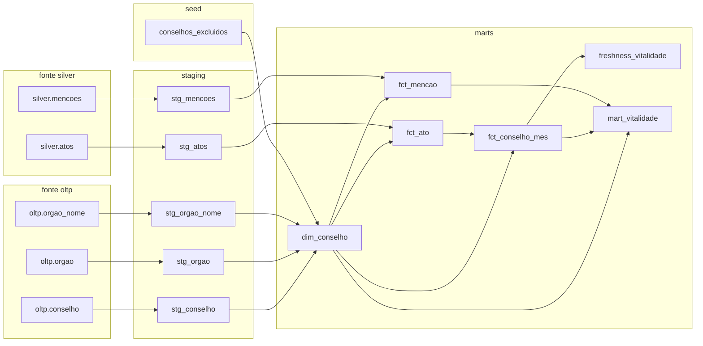

# Linhagem dos dados

De onde vem cada número do painel: do ZIP do Diário Oficial até a tabela que responde à pergunta da E1. A linhagem está em três níveis, do mais geral ao mais detalhado.

## Do dado bruto ao painel

<LinhagemInterativa />

<p class="cv-legenda">Clique numa tabela para ver o que ela guarda, o comando que a gera e os testes que a protegem, ou percorra a linhagem passo a passo.</p>

O Dagster roda os passos do ZIP até a gold num job mensal: `atos_do_mes` → `silver/atos` e `silver/mencoes` → modelos do dbt, com retry e backfill. O grafo dele, como aparece na interface, está em [grafo-dagster.jpg](https://github.com/Luidooo/conselhos-vivos/blob/main/docs/adr/medicoes/0009-gold/grafo-dagster.jpg).

## Dentro do dbt

Gerado do `manifest.json` do dbt pelo `make gold-docs`: é sempre o projeto como está, modelo a modelo, das fontes aos marts.

<!-- linhagem-dbt:inicio -->

<!-- linhagem-dbt:fim -->

## O catálogo completo

O [catálogo do dbt](/linhagem/catalogo-dbt.html){target="_blank"} tem a linhagem interativa de cada modelo, com as colunas, as descrições, os testes e o SQL compilado. Ele é gerado pelo `make gold-docs` (`dbt docs generate --static`) e publicado junto com este site.

Para regerar depois de mudar um modelo:

```bash
make gold && make gold-docs
```
